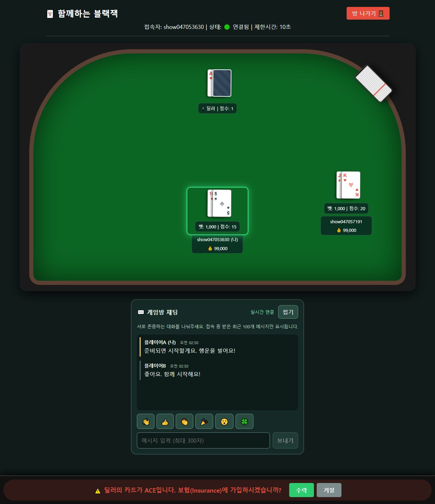
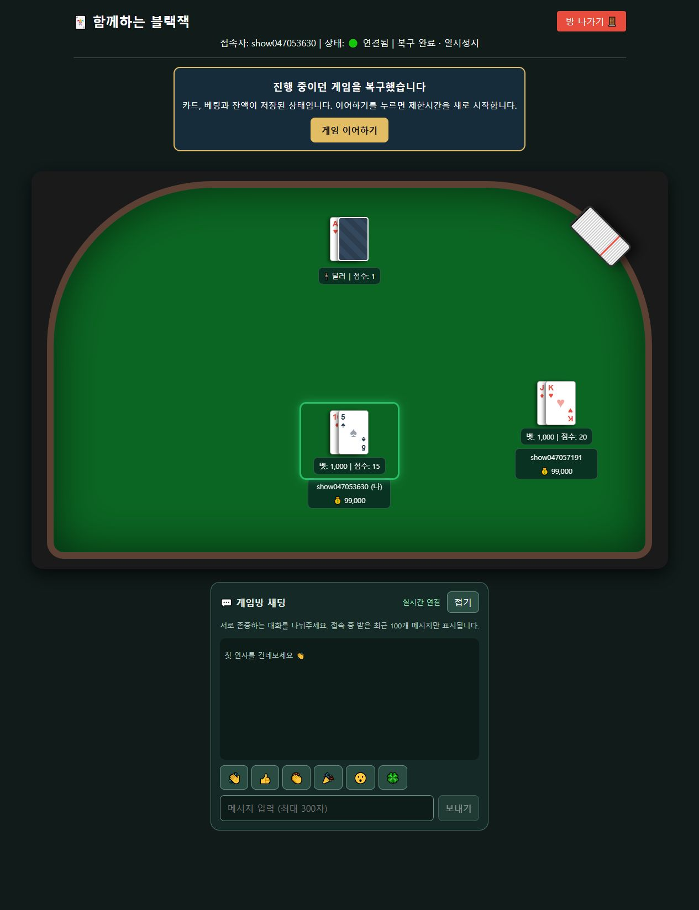
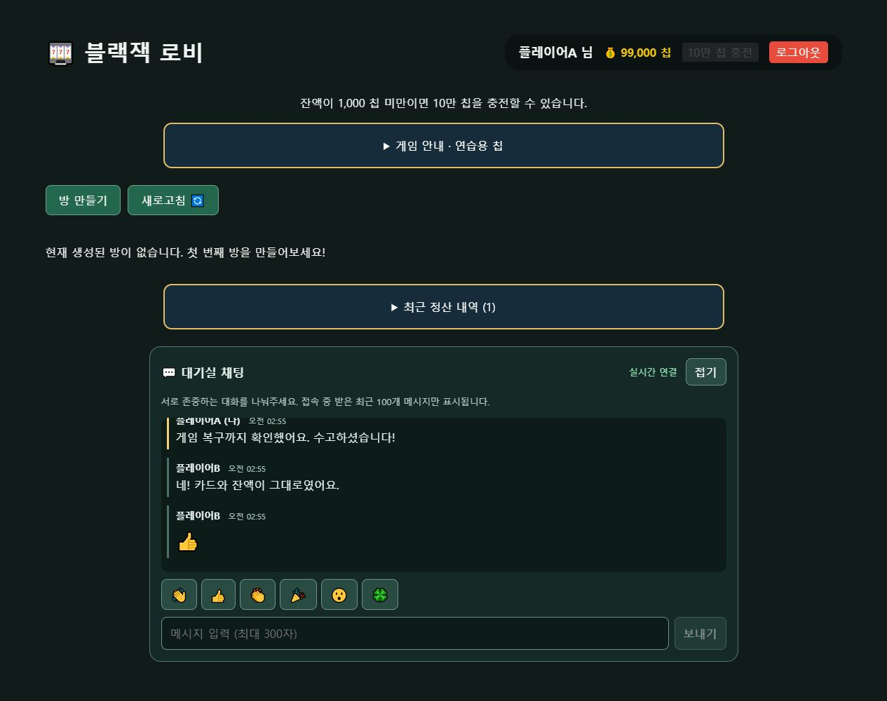
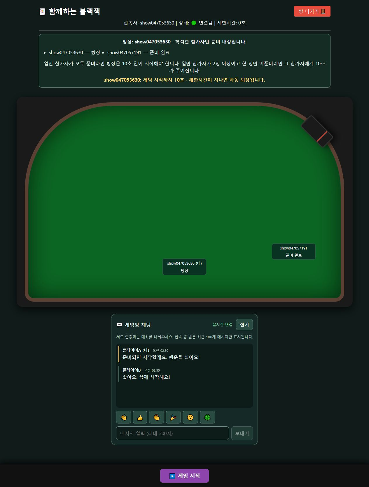
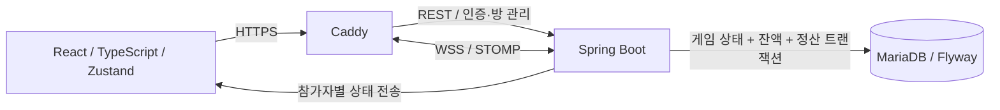
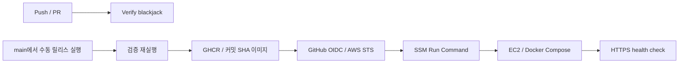
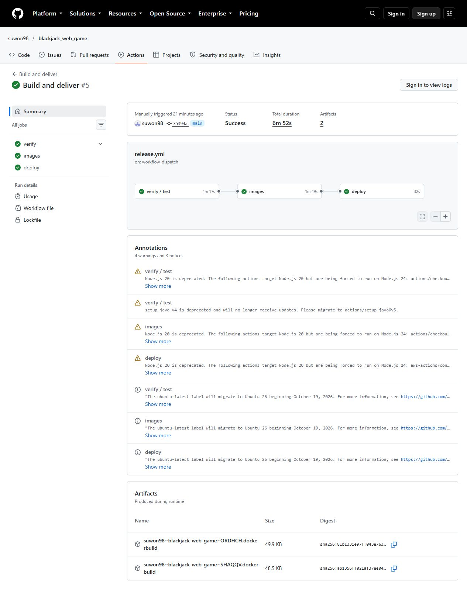

# 실시간 멀티플레이 블랙잭

**같은 테이블에서 플레이하고 대화하며, 서버가 재시작돼도 저장된 게임을 이어가는 웹 게임입니다.**

React · TypeScript · Spring Boot · STOMP/WebSocket · MariaDB · Docker Compose · GitHub Actions · AWS EC2

가상 칩으로 진행하며 실제 결제나 환전 기능은 없습니다. 서버가 카드·차례·베팅·정산을 결정하고 참가자에게 상태를 전달합니다.

현재 공개 서버는 자료와 데이터 보관 후 운영을 종료한 상태입니다. 아래 화면과 Actions 링크는 실제 배포 당시의 기록이며, 직접 실행은 로컬 실행 절차를 참고하세요.

## 실행 화면

2026-10-22 AWS HTTPS 배포 환경의 실제 화면입니다. 촬영용 계정 두 개로 플레이했으며, 합성 화면이 아닙니다.

| 실시간 멀티플레이 | 서버 재시작 후 복구 |
| --- | --- |
|  |  |
| 대기실 채팅 | 방장과 준비 상태 |
|  |  |

[전체 화면과 검증 기록](docs/VERIFICATION.md) · [발표 순서와 설명](docs/PRESENTATION.md)

## 핵심 기능

| 기능 | 동작 |
| --- | --- |
| 실시간 게임 | 1~6인 방, 좌석·관전, 서버 권한 기반 액션과 상태 동기화 |
| 대화 | 대기실/게임방 텍스트와 6종 이모지, 방 참가자만 방 채팅 수신 |
| 준비와 시작 | 착석한 방장만 시작, 일반 참가자 준비 완료/취소, 지연자 10초 강퇴와 방장 위임 |
| 베팅 조절 | 증감 버튼, 직접 입력, 최소 베팅, 100칩 단위 MAX |
| 정산 | 일반 승패, 블랙잭, 보험, 더블다운, 스플릿, 서렌더, 퇴장 후 정산 |
| 저장과 복구 | 게임 스냅샷·잔액·정산 내역 저장, 재시작 후 일시정지 상태로 복구 |
| 변경 전달 | PR 검사 → SHA 태그 이미지 → OIDC/SSM 원격 실행 → HTTPS 상태 검사 |

준비 규칙은 첫 라운드의 대기 상태에 적용합니다. 일반 참가자가 한 명 이상이고 모두 준비하면 방장에게 10초를 주며, 일반 참가자가 두 명 이상이고 한 명만 미준비라면 해당 참가자에게 10초를 줍니다. 관전자는 제외합니다. 자세한 예외·승계·재입장 규칙은 [대기방 정책](docs/ROOM-READY-DEPLOYMENT.md)에 있습니다.

## 구조와 설계



- **서버가 상태를 결정합니다.** 클라이언트의 사용자 지정 값에 의존하지 않고 인증된 연결의 사용자를 확인합니다. 방 잠금과 상태 검증으로 중복·순서가 지난 요청을 처리합니다.
- **정산과 복구를 함께 설계했습니다.** 게임 스냅샷과 잔액을 같은 트랜잭션으로 저장하고 라운드 정산의 중복 지급을 방지합니다. 재시작 후 자동으로 시간을 소진하지 않도록 일시정지하며, 이어하기에서 제한시간을 새로 부여합니다.
- **단일 백엔드 운영을 명시합니다.** 인메모리 STOMP 브로커를 사용하고 DB advisory lock으로 두 번째 쓰기 서버를 차단합니다. 다중 서버 확장이나 고가용성을 구현했다고 주장하지 않습니다.
- **접근 제어를 송수신 모두에 적용합니다.** WebSocket 인증, 방 구독/전송 권한, 퇴장 후 수신 차단과 메시지 제한을 검사합니다. [보안 검증 범위](docs/SECURITY.md)를 참고하세요.

## CI/CD와 실제 배포



Push와 PR은 검사를 실행합니다. 배포는 `Build and deliver`를 main에서 수동 실행하고 `deploy=true`로 선택했을 때만 진행하며, 이후 검증·이미지 빌드·배포가 자동으로 이어집니다. `deploy=false`는 이미지 게시까지만 수행합니다. 장기 AWS 액세스 키 대신 OIDC를 사용하고, 서버는 배포 전 DB 백업을 만든 뒤 상태 검사를 수행합니다.

검증된 릴리스: **`35394afb835775119716c0c0dc9c417b5815b3ab`**

- [main 검사 성공](https://github.com/suwon98/blackjack_web_game/actions/runs/39643303824)
- [테스트 → 이미지 → 배포 성공](https://github.com/suwon98/blackjack_web_game/actions/runs/39644266613)
- [방장·준비·베팅 조절 PR #4](https://github.com/suwon98/blackjack_web_game/pull/4)
- [AWS 구성과 배포 절차](docs/AWS-DEPLOYMENT.md)



## 실행과 검증

Node.js 24, JDK 17 Gradle toolchain, PowerShell 7을 준비합니다.

```powershell
git clone https://github.com/suwon98/blackjack_web_game.git
cd blackjack_web_game
.\start-local.ps1
```

`http://localhost:5173`에서 회원가입 → 방 만들기/입장 → 착석 → 일반 참가자 준비 → 방장 시작 순서로 진행합니다. 두 계정은 서로 다른 브라우저 프로필을 사용하세요. 종료는 `.\stop-local.ps1`입니다. 로컬 프로필은 H2 파일에 데이터를 저장합니다. MariaDB Compose 실행은 `.\start-compose.ps1`이며 `http://localhost:18081`에 접속합니다.

```powershell
cd blackjack
.\gradlew.bat test bootJar --no-daemon
cd ..\frontend\frontend-blackjack
npm ci
npm test
npm run lint
npm run build
```

CI는 백엔드 40개 테스트와 베팅 9개 테스트 외에도 실제 HTTP/STOMP 검사를 실행합니다. `restart-smoke.mjs`는 강제 종료·복구, `ready-smoke.mjs`는 준비·강퇴, `smoke.mjs`는 2인 3라운드 정산, `chat-smoke.mjs`와 `security-smoke.mjs`는 대화·권한을 검사합니다. MariaDB Compose 검사와 배포 스크립트 검사도 포함합니다. 테스트 계정이 생성되므로 독립된 검증 환경에서 실행하세요.

## 구현 중 해결한 문제

| 관찰한 문제 | 해결과 확인 |
| --- | --- |
| 잔액 96,850에서 MAX 선택 시 100단위 규칙 위반 | 96,800으로 내림, 잔여 50 보존, 경계값 회귀 테스트 |
| 일반 참가자도 게임 시작 가능 | 서버에서 방장 권한 검사, 준비 상태와 지연 강퇴 통합 검사 |
| 베팅 버튼을 잘못 누르면 되돌리기 어려움 | 금액 감소·직접 입력·최소액 초기화 추가 |
| 비동기 정산 완료 전에 테스트가 잔액 검사 | 완료된 정산을 기다리도록 검사 안정화 |
| 재시작 시 진행 중 상태 유실 가능 | DB 스냅샷 복구와 잔액 대조, 실제 배포 서버 재시작 촬영 |

## 현재 범위와 다음 개선

- 대화는 현재 화면에서 수신한 최근 100개만 보관하며 DB에 영구 저장하지 않습니다.
- 같은 브라우저 프로필의 탭은 로그인 저장소를 공유합니다. 독립된 사용자 시험에는 별도 프로필이 필요합니다.
- 자동 다음 라운드/자동 최소 베팅의 참여 중단 제어, 좁은 화면 배치, 로그인 ID 대신 닉네임 표시를 개선할 수 있습니다.
- Google OAuth는 선택 기능이며 실제 외부 인증은 검증하지 않았습니다.
- 대규모 부하·다중 서버·장애 조치 시험은 수행하지 않았습니다.
- Actions 실행은 성공했으나 일부 액션 버전과 러너 변경에 관한 경고가 남아 있습니다. 버전 갱신은 별도 변경과 회귀 검사로 진행할 항목입니다.

운영 데이터와 인증 설정은 공개 자료에 포함하지 않습니다. 배포 환경의 보관·종료 상태는 [검증 기록](docs/VERIFICATION.md)에 구분해 기록합니다. [백업·복원 안내](docs/DEPLOYMENT.md)도 참고하세요.

상세 카드·지급·제한시간 규칙은 [게임 규칙](docs/GAME-RULES.md)을 참고하세요.
